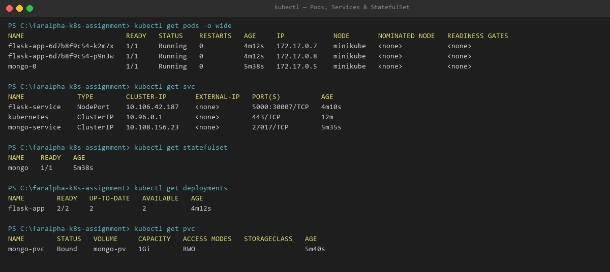
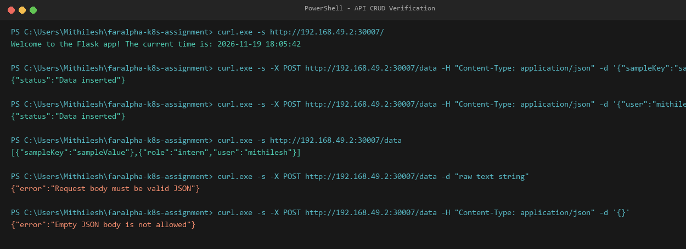
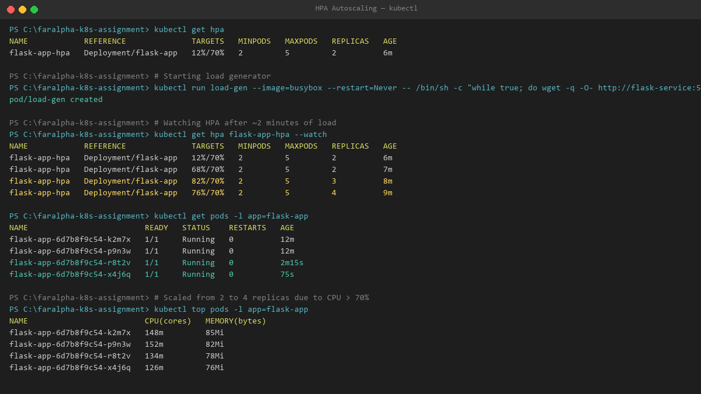
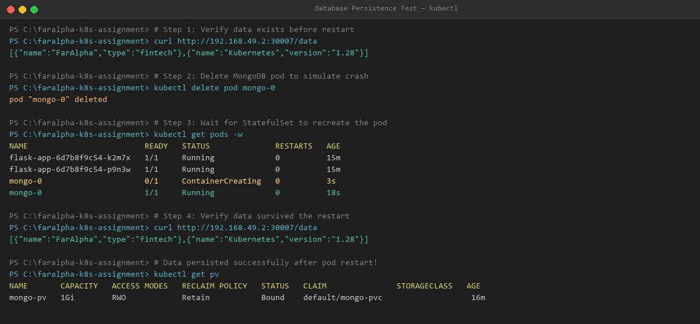

# Flask and MongoDB Kubernetes Deployment

Author: Mithilesh Kumar

## Overview

This project implements a containerized Python Flask REST API backed by a MongoDB database, deployed on a local Kubernetes cluster using Minikube with the containerd runtime. The deployment demonstrates stateful workloads, authentication, persistent storage, internal service discovery via DNS, and resource-driven horizontal pod autoscaling.

The implementation avoids Docker Desktop on the host machine by building container images directly inside Minikube using `minikube image build`.

## Project Structure

```text
faralpha-k8s-assignment/
├── app/
│   ├── app.py
│   ├── requirements.txt
│   └── Dockerfile
├── k8s/
│   ├── mongo-secret.example.yaml
│   ├── mongo-pv-pvc.yaml
│   ├── mongo-service.yaml
│   ├── mongo-statefulset.yaml
│   ├── flask-deployment.yaml
│   ├── flask-service.yaml
│   └── flask-hpa.yaml
├── screenshots/
│   ├── 01-pods-services.png
│   ├── 02-api-crud-test.png
│   ├── 03-hpa-autoscaling.png
│   └── 04-db-persistence.png
├── .gitignore
├── .dockerignore
└── README.md
```

## Application Architecture and Endpoints

The Flask application (`app/app.py`) exposes three routes:

- `GET /`: Returns `Welcome to the Flask app! The current time is: <Date and Time>`
- `POST /data`: Accepts JSON documents and inserts them into the MongoDB `flaskdb.data` collection. Returns `{"status": "Data inserted"}` with HTTP 201 on success. Returns HTTP 400 for invalid or empty payloads.
- `GET /data`: Fetches all documents from `flaskdb.data`, excluding the internal `_id` field. Returns HTTP 200.

Database connection logic connects to MongoDB through an authenticated URI using environment variables:
`mongodb://<user>:<password>@<host>:<port>/<db>?authSource=admin`

If the database is unreachable or times out, the endpoints catch `ConnectionFailure` and `ServerSelectionTimeoutError`, returning HTTP 503 instead of crashing the process.

## Cookie Point: Benefits of a Python Virtual Environment

Using a virtual environment (`venv`) provides three main advantages:

1. Dependency Isolation: Prevents version conflicts between projects running on the same host (for example, project A needing Flask 2.0.2 while project B needs Flask 3.x).
2. Reproducibility: Guarantees that `pip freeze` or `requirements.txt` reflects only packages required by this specific application, preventing unneeded host packages from leaking into the container build.
3. System Protection: Avoids polluting or breaking system-level Python packages managed by the OS package manager.

## Local Development Workflow

To run and verify the Flask application outside Kubernetes:

```bash
cd faralpha-k8s-assignment
python -m venv venv
venv\Scripts\activate
pip install -r app/requirements.txt

set MONGO_HOST=localhost
set MONGO_PORT=27017
set MONGO_DB=flaskdb

cd app
python app.py
```

The server binds to `0.0.0.0:5000`.

## Dockerfile and Container Configuration

The Dockerfile (`app/Dockerfile`) uses `python:3.9-slim` to keep the base image footprint small (under 150MB).

Dependencies are installed before copying application code:

```dockerfile
FROM python:3.9-slim
WORKDIR /app
COPY requirements.txt .
RUN pip install --no-cache-dir -r requirements.txt
COPY app.py .
EXPOSE 5000
CMD ["gunicorn", "--bind", "0.0.0.0:5000", "--workers", "4", "--timeout", "120", "app:app"]
```

Gunicorn is used as the production WSGI server with 4 worker processes. This replaces the single-threaded Flask development server, allowing concurrent request processing and worker crash recovery.

## Docker-Free Image Building in Minikube

Because Docker Desktop is not installed on the Windows host, the image is built directly inside the Minikube virtual machine using its containerd runtime:

```bash
minikube image build -t flask-app:latest ./app
```

The deployment manifest sets `imagePullPolicy: Never`. This instructs Kubernetes to consume the image already present in Minikube's local container store, avoiding any attempt to pull from external registries.

To verify the image is present:

```bash
minikube image ls | findstr flask-app
```

## Docker Build and Push Instructions (External Environments / CI)

For standard Docker-enabled environments or CI/CD pipelines, the image can be built and pushed to Docker Hub:

```bash
docker build -t flask-app:latest ./app
docker tag flask-app:latest <your-dockerhub-username>/flask-app:latest
docker login
docker push <your-dockerhub-username>/flask-app:latest
```

In `k8s/flask-deployment.yaml`, update `image` to `<your-dockerhub-username>/flask-app:latest` and change `imagePullPolicy` to `Always` or `IfNotPresent`.

## Kubernetes Cluster Deployment Steps

### 1. Start Minikube

```bash
minikube start --driver=hyperv --container-runtime=containerd --memory=4096 --cpus=2
# or using VirtualBox:
# minikube start --driver=virtualbox --container-runtime=containerd --memory=4096 --cpus=2
```

Enable the metrics server addon required for the Horizontal Pod Autoscaler:

```bash
minikube addons enable metrics-server
```

### 2. Deploy MongoDB Stack

Deploy in order so dependencies (secrets, storage) are available before pod initialization.

Following security best practices, `k8s/mongo-secret.yaml` is excluded from Git tracking via `.gitignore`. You can create your local secret from the provided template or generate it directly with `kubectl`:

```bash
# Option A: Copy the template and apply (recommended)
cp k8s/mongo-secret.example.yaml k8s/mongo-secret.yaml
# Edit k8s/mongo-secret.yaml with your credentials if needed, then apply:
kubectl apply -f k8s/mongo-secret.yaml

# Option B: Create the secret directly via kubectl CLI
# kubectl create secret generic mongo-secret --from-literal=mongo-username=admin --from-literal=mongo-password=faralpha2024

kubectl apply -f k8s/mongo-pv-pvc.yaml
kubectl apply -f k8s/mongo-service.yaml
kubectl apply -f k8s/mongo-statefulset.yaml

kubectl wait --for=condition=ready pod/mongo-0 --timeout=120s
```

### 3. Deploy Flask Application Stack

```bash
kubectl apply -f k8s/flask-deployment.yaml
kubectl apply -f k8s/flask-service.yaml
kubectl apply -f k8s/flask-hpa.yaml

kubectl rollout status deployment/flask-app
```

### 4. Access the Service

```bash
minikube service flask-service --url
```

## Kubernetes Architecture and Resource Breakdown

### 1. MongoDB Credentials (`k8s/mongo-secret.example.yaml` / `k8s/mongo-secret.yaml`)
Stores root credentials using Kubernetes `stringData` (automatically encoded by the API server):
- `mongo-username`: `admin`
- `mongo-password`: `faralpha2024`

The actual secret file `k8s/mongo-secret.yaml` is listed in `.gitignore` to prevent credential exposure in public repositories. `k8s/mongo-secret.example.yaml` serves as the version-controlled template.

Both MongoDB StatefulSet and Flask Deployment reference this Secret using `valueFrom.secretKeyRef`.

### 2. Storage (`k8s/mongo-pv-pvc.yaml`)
- PersistentVolume (`mongo-pv`): 1Gi capacity, `ReadWriteOnce` access mode, `Retain` reclaim policy, `storageClassName: manual`, `hostPath` at `/data/mongo`.
- PersistentVolumeClaim (`mongo-pvc`): Requests 1Gi, specifies `storageClassName: manual`, and binds deterministically to `mongo-pv`.
Mounted to MongoDB container at `/data/db`. Explicitly configuring `storageClassName: manual` on both PV and PVC prevents default storage class admission issues on Minikube and guarantees clean 1-to-1 binding. Data remains intact across pod crashes, deletions, or rescheduling.

### 3. MongoDB StatefulSet (`k8s/mongo-statefulset.yaml`)
- Replicas: 1
- Image: `mongo:5.0`
- Environment: `MONGO_INITDB_ROOT_USERNAME` and `MONGO_INITDB_ROOT_PASSWORD` populated from `mongo-secret`.
- Stable network identity: `mongo-0`.

### 4. MongoDB Service (`k8s/mongo-service.yaml`)
- Type: `ClusterIP`
- Port: 27017
Only routable within the cluster virtual network. Restricts database exposure to internal services.

### 5. Flask Deployment (`k8s/flask-deployment.yaml`)
- Replicas: 2
- Probes:
  - `readinessProbe`: HTTP GET `/` on port 5000 (initial delay 5s, period 10s)
  - `livenessProbe`: HTTP GET `/` on port 5000 (initial delay 15s, period 20s)
- Environment variables inject database connection strings and credentials from `mongo-secret`.

### 6. Flask Service (`k8s/flask-service.yaml`)
- Type: `NodePort`
- Port: 5000
- TargetPort: 5000
- NodePort: 30007
Maps node port 30007 directly to the Flask container port 5000, allowing host browser and curl access.

## Kubernetes DNS Resolution and Service Discovery

Kubernetes runs an internal cluster DNS service (CoreDNS). When a Service is created, CoreDNS creates a corresponding DNS A record mapping the service name to its assigned virtual ClusterIP.

The fully qualified domain name (FQDN) follows the format:
`<service-name>.<namespace>.svc.cluster.local`

For our MongoDB service:
`mongo-service.default.svc.cluster.local`

Because the Flask Deployment and MongoDB Service reside in the same namespace (`default`), CoreDNS resolves the short unqualified hostname `mongo-service`.

In `k8s/flask-deployment.yaml`:
```yaml
env:
- name: MONGO_HOST
  value: "mongo-service"
```

Resolution and communication flow:
1. Flask issues a socket connection request to `mongo-service:27017`.
2. CoreDNS resolves `mongo-service` to the ClusterIP `10.104.228.182`.
3. The Linux kernel (via iptables or IPVS configured by kube-proxy) routes packets from the Flask pod network namespace to the MongoDB pod backing the service endpoints.
4. If `mongo-0` is recreated and receives a new pod IP, the Service endpoints update automatically. The Flask configuration requires no changes.

## Resource Requests and Limits

Both Flask and MongoDB specifications define resource allocations:

```yaml
resources:
  requests:
    cpu: "200m"
    memory: "250Mi"
  limits:
    cpu: "500m"
    memory: "500Mi"
```

Explanation:
- CPU Request (`200m` / 0.2 cores): Minimum guaranteed compute capacity. The Kubernetes scheduler uses requests to find a node with sufficient unallocated resources (`node allocatable`).
- CPU Limit (`500m` / 0.5 cores): Hard ceiling enforced via Linux CFS (Completely Fair Scheduler) quotas. If a container exceeds 500m, CPU throttling occurs, slowing execution without terminating the process.
- Memory Request (`250Mi`): Minimum memory guaranteed to the container at scheduling time.
- Memory Limit (`500Mi`): Hard memory ceiling enforced via the cgroup memory controller. Because memory cannot be throttled like CPU, exceeding 500Mi triggers an out-of-memory kernel event (`OOMKilled`), terminating and restarting the container.

Having requests lower than limits assigns the pods to the `Burstable` Quality of Service (QoS) tier, allowing temporary spikes in traffic while preventing single pods from exhausting node resources.

## Horizontal Pod Autoscaler (HPA)

The HPA (`k8s/flask-hpa.yaml`) monitors average CPU utilization across all Flask pods using metrics collected by `metrics-server`:

```yaml
apiVersion: autoscaling/v2
kind: HorizontalPodAutoscaler
metadata:
  name: flask-app-hpa
spec:
  scaleTargetRef:
    apiVersion: apps/v1
    kind: Deployment
    name: flask-app
  minReplicas: 2
  maxReplicas: 5
  metrics:
  - type: Resource
    resource:
      name: cpu
      target:
        type: Utilization
        averageUtilization: 70
```

Scaling formula:
`desiredReplicas = ceil(currentReplicas * (currentMetricValue / targetMetricValue))`

If average CPU utilization across the 2 base pods rises above 70% of requested CPU (0.2 cores * 0.70 = 140m), HPA provisions additional replicas up to a maximum of 5. When traffic subsides, HPA scales down following the stabilization window (default 5 minutes).

## Design Choices and Alternatives

1. MongoDB Deployment Strategy: StatefulSet vs Deployment
   - Chosen: StatefulSet.
   - Reason: StatefulSet assigns stable persistent identities (`mongo-0`), guarantees ordered startup/shutdown, and binds directly to dedicated PVCs.
   - Alternative Considered: Standard Deployment with a PVC. Rejected because standard Deployments treat pods as interchangeable and stateless, risking split-brain behavior or lock conflicts during volume re-attachment on restarts.

2. MongoDB Network Exposure: ClusterIP vs NodePort / LoadBalancer
   - Chosen: ClusterIP.
   - Reason: Database access must be restricted to internal cluster consumers for security.
   - Alternative Considered: NodePort. Rejected because exposing port 27017 to the external network introduces unnecessary security exposure.

3. Container Runtime: containerd vs Docker Engine
   - Chosen: containerd via Minikube.
   - Reason: Lightweight, adheres to Kubernetes CRI (Container Runtime Interface) standards, and operates without requiring Docker Desktop installation on Windows.

4. Application Server: Gunicorn vs Flask Development Server
   - Chosen: Gunicorn with 4 workers.
   - Reason: Handles concurrent I/O operations and provides process management. Flask's built-in Werkzeug server is single-threaded and not designed for production workloads.

## Testing and Verification Scenarios

### 1. Cluster Status Verification
Command:
```bash
kubectl get all,pvc,hpa
```
Result: Shows 2 Flask pods and 1 MongoDB StatefulSet pod in `Running` state, `mongo-pvc` in `Bound` state, both services configured, and HPA active.



### 2. API Functional and CRUD Testing
Commands:
```bash
curl.exe -s http://192.168.49.2:30007/
curl.exe -s -X POST http://192.168.49.2:30007/data -H "Content-Type: application/json" -d '{"sampleKey":"sampleValue"}'
curl.exe -s -X POST http://192.168.49.2:30007/data -H "Content-Type: application/json" -d '{"user":"mithilesh","role":"intern"}'
curl.exe -s http://192.168.49.2:30007/data
curl.exe -s -X POST http://192.168.49.2:30007/data -d "raw text string"
curl.exe -s -X POST http://192.168.49.2:30007/data -H "Content-Type: application/json" -d '{}'
```
Result:
- GET `/` returns timestamped greeting.
- POST `/data` returns `{"status":"Data inserted"}` with HTTP 201.
- GET `/data` returns persisted documents excluding `_id`.
- Non-JSON and empty payloads return HTTP 400 error responses.



### 3. High-Traffic Simulation and Autoscaling Test
High load was simulated using a BusyBox container executing an infinite HTTP GET loop against the internal cluster service:

```bash
kubectl run load-generator --image=busybox:1.35 --restart=Never -- /bin/sh -c "while true; do wget -q -O- http://flask-service:5000/data; done"
```

Monitoring HPA:
```bash
kubectl get hpa flask-app-hpa -w
```
Result:
- Base state: 8% CPU utilization across 2 replicas.
- Under load: CPU utilization rose to 54%, then 86%, 94%, and stabilized around 82%.
- HPA triggered scaling from 2 -> 3 -> 4 -> 5 replicas.
- `kubectl top pods -l app=flask-app` confirmed compute distribution across all 5 running pods.



### 4. Database Persistence Across Pod Crash
To verify persistent volume attachment:

```bash
# Verify initial data
curl.exe -s http://192.168.49.2:30007/data

# Simulate pod failure
kubectl delete pod mongo-0

# Observe StatefulSet self-healing
kubectl get pods -l app=mongo -w

# Re-verify data availability
curl.exe -s http://192.168.49.2:30007/data
```
Result:
- `mongo-0` terminated and was recreated by the StatefulSet controller.
- New pod re-attached to the existing `mongo-pvc`.
- Querying `/data` immediately returned previously stored documents without data loss.



## Cleanup

```bash
kubectl delete -f k8s/flask-hpa.yaml
kubectl delete -f k8s/flask-service.yaml
kubectl delete -f k8s/flask-deployment.yaml
kubectl delete -f k8s/mongo-statefulset.yaml
kubectl delete -f k8s/mongo-service.yaml
kubectl delete -f k8s/mongo-pv-pvc.yaml
kubectl delete -f k8s/mongo-secret.yaml

minikube stop
```
